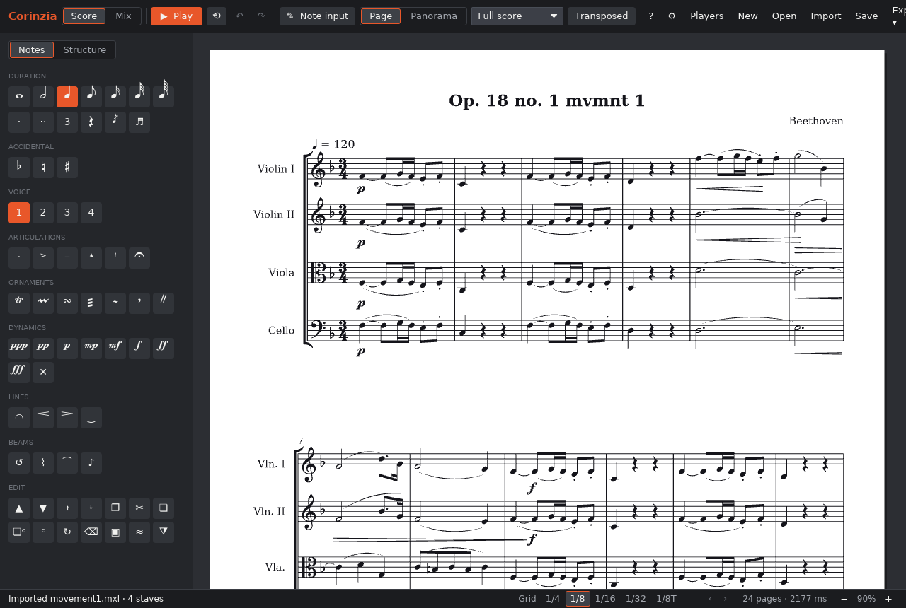
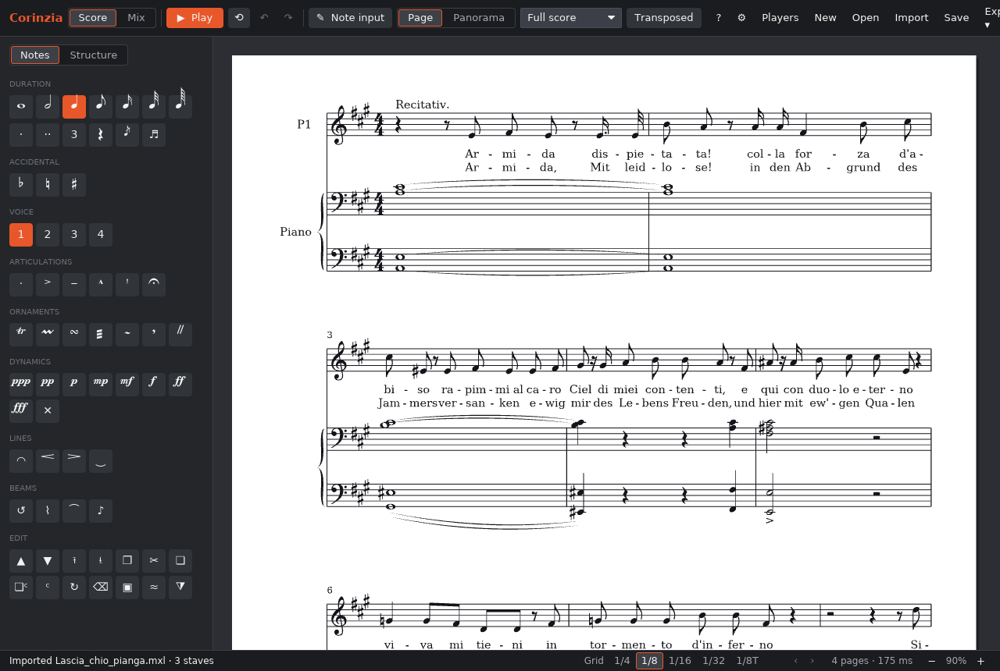
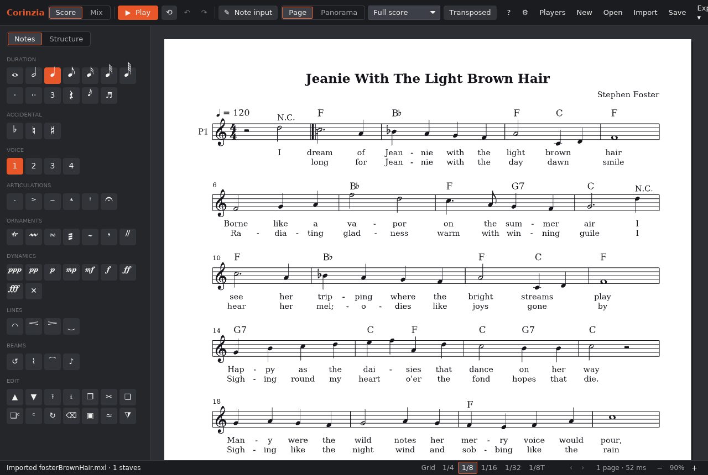
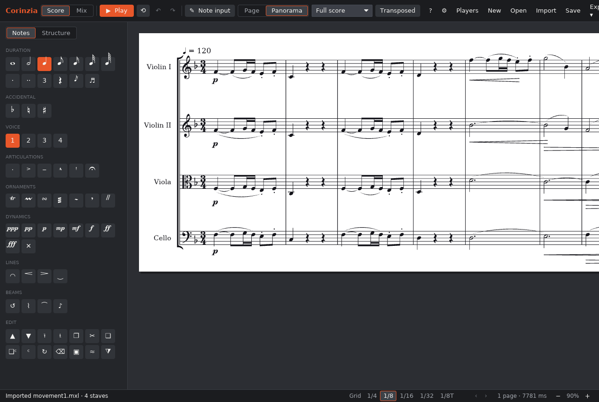
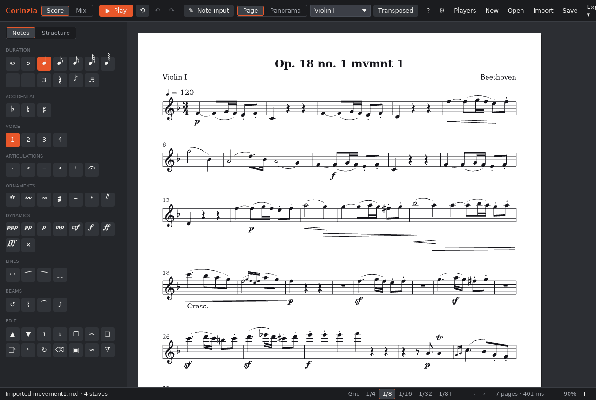
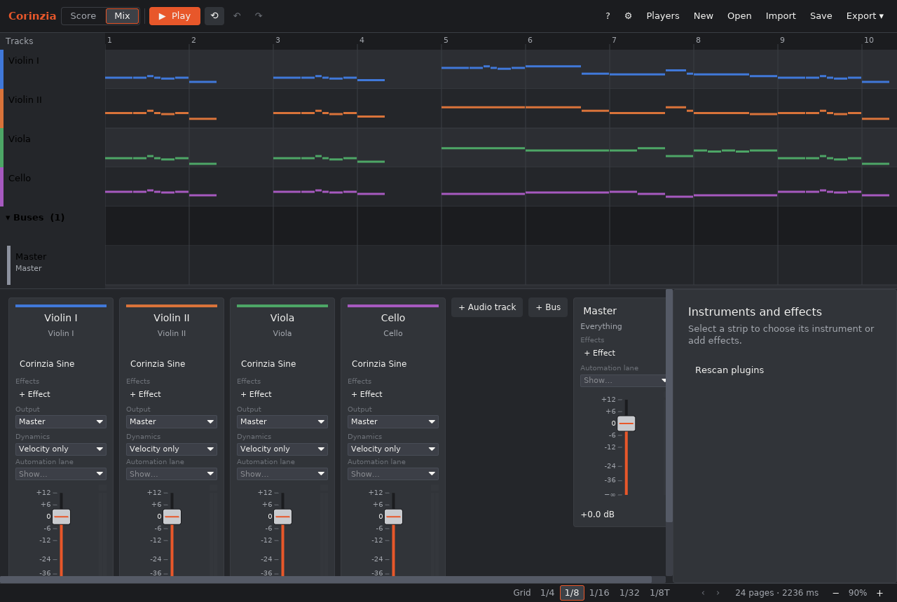
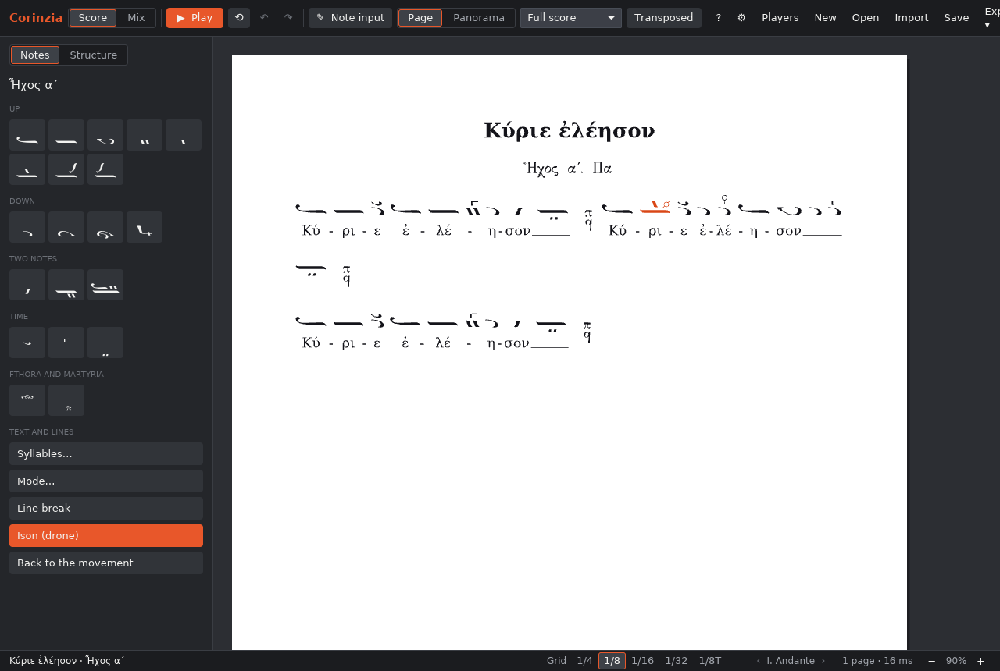
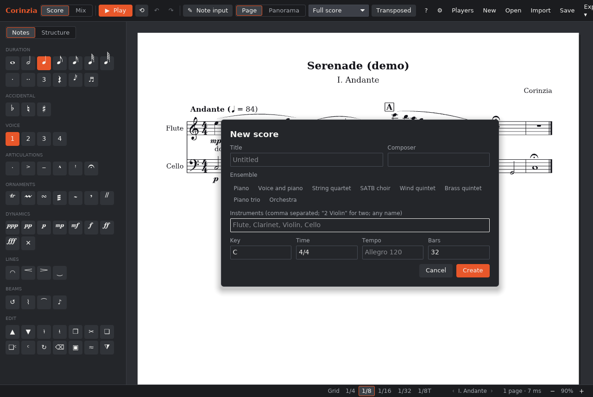
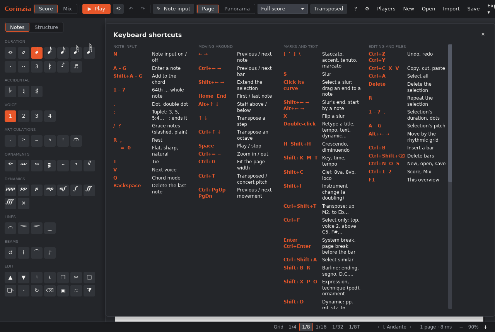
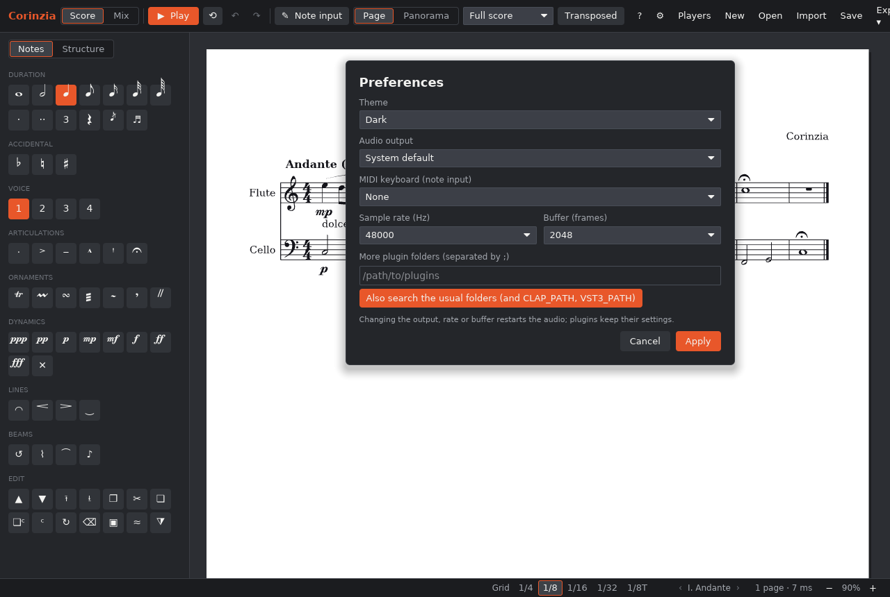

# Corinzia

### Write it like a score. Hear it like a record.

[](https://remade.wiki/projects/corinzia/)

Corinzia is a music notation program and a DAW in one window. Write your
music on beautifully engraved pages, then play it back through your own
CLAP and VST3 instruments and effects, mixed like a production. It doesn't
convert between two programs or round-trip through MIDI: it's one piece of
music, on the page and in the mix.

It also writes **Byzantine chant** alongside Western music, and sings it
back in the true intervals of each mode.



> **Early preview.** Corinzia is moving fast and isn't finished. It's great
> for trying out and for real sketches, but keep MusicXML exports of
> anything important while the file format settles.

## Engraving you'd be proud to print

Corinzia sets music the way a professional engraver would. Slurs curve
around the notes, beams follow the meter, lyrics and chord symbols find
their room, and every page is crisp at any zoom. PDFs come straight from
the same engraver, so what you see is exactly what prints.



Songs and lead sheets get the same care: lyrics in several verses,
hyphens and extenders, and chord symbols written as you'd say them
("F#m7b5/E").



## Every way you need to see it

Flip between printed pages and one endless Panorama strip for writing. Each
player gets their own part, laid out on its own pages with multi-bar rests,
ready to hand out.





## A real mixing desk behind the score

Switch to the Mix tab and your score becomes a session. Each player is a
track with its own instrument plugin, effects, sends, buses and automation.
Drop in audio files, shape how notes are played in the piano roll, and
export the whole thing as a finished WAV.



* **Your plugins:** any CLAP or VST3 instrument or effect, each with its own
  editor and saved sound.
* **Mix like a DAW:** faders, pan, mute, solo, buses, pre- and post-fader
  sends, level meters, and the built-in EQ, reverb and limiter.
* **Automation:** fader, pan, any plugin parameter, MIDI controllers and
  pitch bend.
* **Expression maps:** pizz., arco, con sord. and staccato switch your
  sample library's articulations automatically.
* **Audio tracks:** clips you can trim, fade and cue in the score.

## Byzantine chant, sung in tune

Corinzia writes Chrysanthine notation with the same care it gives a
symphony. Neumes, time signs, gorgons, fthoras and martyriae are engraved
in proper Byzantine type, with Greek syllables underneath. Press Space and
the chant is sung back in the true intervals of its mode, diatonic, soft or
hard chromatic, with the ison held underneath. Corinzia even checks your
martyriae against the melody.



## Fast to write in

Type notes from the keyboard, click them in, or play them on a MIDI
keyboard. Start a new score from an ensemble in seconds, and find every
shortcut a keystroke away (F1).







## Plays well with others

Open and save MusicXML, including compressed `.mxl`, to move scores to
and from other notation programs. Export PDF (score and parts), MIDI and
WAV.

## Download

**Linux:** download `Corinzia-…-x86_64.AppImage` from
[Releases](https://github.com/githuhl/corinzia/releases), make it executable
and run it:

```bash
chmod +x Corinzia-*-x86_64.AppImage
```

```bash
./Corinzia-*-x86_64.AppImage
```

It runs on most 64-bit distributions from 2020 on (Ubuntu 20.04, Debian 11,
Fedora 32 and later), with PipeWire for sound. It finds the CLAP and VST3
plugins you already have installed.

**Windows:** download `Corinzia-…-x86_64-windows.zip`, unzip it and run
`corinzia.exe`. It finds your CLAP and VST3 plugins in their usual folders.

Corinzia is free and open source.

## Learn more

* [User guide](docs/GUIDE.md): every feature, and how to use it
* [Developing Corinzia](docs/DEVELOPING.md): building from source and how
  it's made

Found a bug or missing something? Please
[open an issue](https://github.com/githuhl/corinzia/issues).

*Screenshots show public-domain works (Beethoven, Handel, Stephen Foster)
from the music21 corpus.*
